 

 

 

> **A UML-based design of an Airport Management System** that models passenger check-in, boarding passes, baggage processing, security and immigration clearance, flight and gate management, boarding, and supporting airport services.

 

**OOAD Project Review · Team 7**

---

## 📋 Table of Contents

- [🎯 Project Overview](#-project-overview)
- [✨ System Features](#-system-features)
- [👥 Actors & Responsibilities](#-actors--responsibilities)
- [🏗️ System Architecture](#️-system-architecture)
- [📊 Passenger Operations Flow](#-passenger-operations-flow)
- [🧩 UML Diagrams](#-uml-diagrams)
  - [Use Case Diagram](#1-use-case-diagram)
  - [Class Diagram](#2-class-diagram)
  - [Sequence Diagrams](#3-sequence-diagrams)
  - [State Chart Diagram](#4-state-chart-diagram)
  - [Activity Diagram](#5-activity-diagram)
  - [Component Diagram](#6-component-diagram)
  - [Deployment Diagram](#7-deployment-diagram)
- [✈️ Flight Lifecycle](#️-flight-lifecycle)
- [🗂️ Core System Entities](#️-core-system-entities)
- [✅ Key Benefits](#-key-benefits)
- [👨‍💻 Team Members](#-team-members)
- [📝 Notes](#-notes)

---

## 🎯 Project Overview

The **Airport Management System (AMS)** is designed to streamline and coordinate airport operations from passenger check-in to final boarding. It represents the interactions between passengers and airport personnel and the services needed to manage baggage, security and immigration clearance, flight status, gates, traveller buses, assistance requests, lounge access, and operational reports.

The project applies **Object-Oriented Analysis and Design (OOAD)** principles. UML diagrams describe the system from multiple perspectives: functional requirements, static structure, chronological interactions, workflows, state transitions, software components, and deployment architecture.

### Project Objectives

- Model the main actors and functions involved in airport operations.
- Represent key airport entities and their relationships.
- Document time-ordered interactions for check-in, baggage processing, security, and boarding.
- Illustrate the passenger journey and flight lifecycle.
- Show the logical software components and their dependencies.
- Represent the intended deployment across client devices, application services, database, and notification services.

### Project Scope

- Passenger registration and login
- Flight tracking and gate status
- Passenger check-in and boarding-pass generation
- Baggage management
- Security and immigration clearance
- Gate allocation and boarding
- Traveller-bus management
- Special-assistance requests and lounge access
- Flight management and operational reporting
- Notifications

---

## ✨ System Features

| Feature | Description |
|---|---|
| 👤 Passenger Management | Registration, login, and passenger-related operations |
| 🎫 Check-in & Boarding Pass | Check-in processing and boarding-pass generation |
| 🧳 Baggage Management | Register and track baggage-processing status |
| 🛂 Security Clearance | Record security verification outcomes |
| 🛃 Immigration Clearance | Represent immigration verification by authorized personnel |
| ✈️ Flight Management | Manage flight schedules, status, delays, and cancellations |
| 🚪 Gate Management | Allocate gates and support boarding operations |
| 🚌 Traveller-Bus Management | Represent passenger transfer coordination |
| ♿ Assistance & Lounge Access | Handle assistance requests and lounge-access operations |
| 🔔 Notifications | Represent SMS/email notifications for relevant updates |
| 📈 Reports | Support operational reporting for administrators |

---

## 👥 Actors & Responsibilities

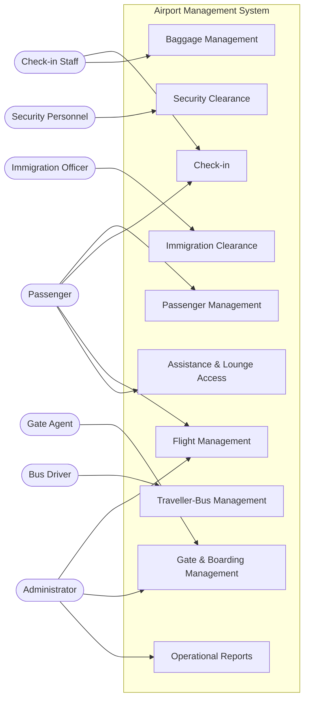

| Actor | Main Responsibilities |
|---|---|
| Passenger | Register/login, check in, receive boarding pass, track flights, request assistance, and access lounge services |
| Check-in Staff | Assist with check-in and baggage processing |
| Security Personnel | Perform and record security verification |
| Immigration Officer | Perform immigration clearance |
| Gate Agent | Manage gate-side boarding operations |
| Bus Driver | Support traveller-bus transportation |
| Administrator | Manage flights and operational information and generate reports |

---

## 🏗️ System Architecture

The following is a logical architecture view based on the project presentation. It groups the airport system into client access, application services, persistent data, and notifications. It does not imply that the project has already been deployed.

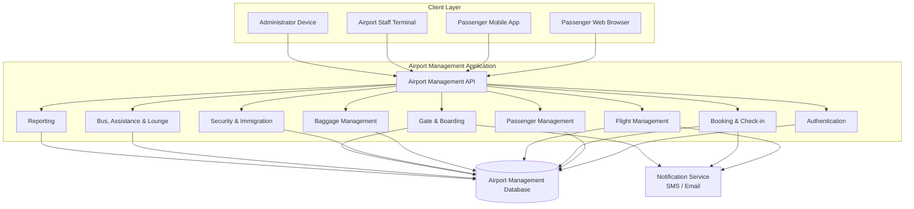

### Architecture Layers

- **Client layer:** Passenger, staff, and administrator access points.
- **Application layer:** Logical services for authentication, passengers, bookings, flights, baggage, clearance, gates, support services, and reporting.
- **Data layer:** Central database for storing and retrieving operational information.
- **Notification layer:** SMS/email notification integration.

---

## 📊 Passenger Operations Flow

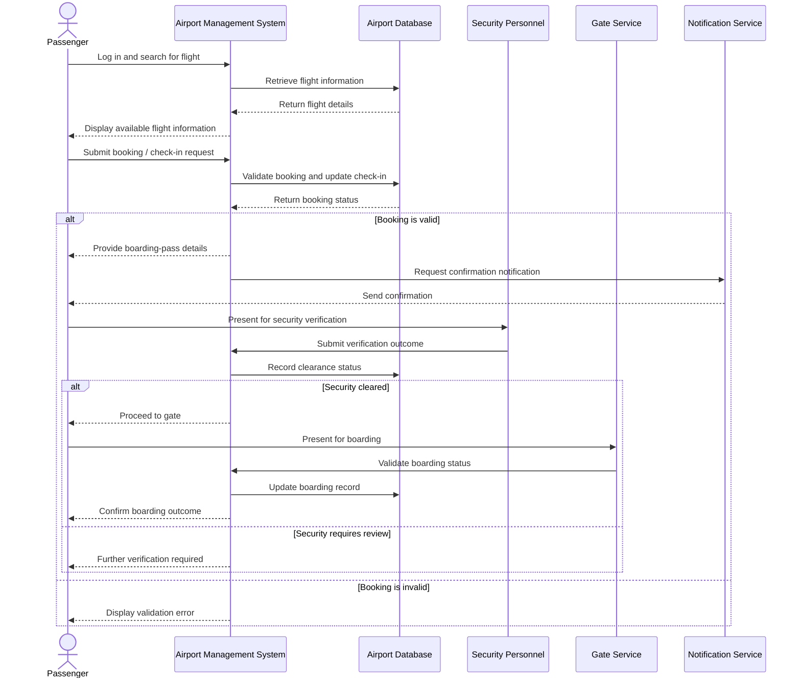

This sequence is a high-level summary of the passenger workflow. The detailed check-in, baggage/security, and boarding sequences appear below.

---

# 🧩 UML Diagrams

## 1. Use Case Diagram

**Purpose:** Shows the actors that interact with the Airport Management System and the functions available to them.

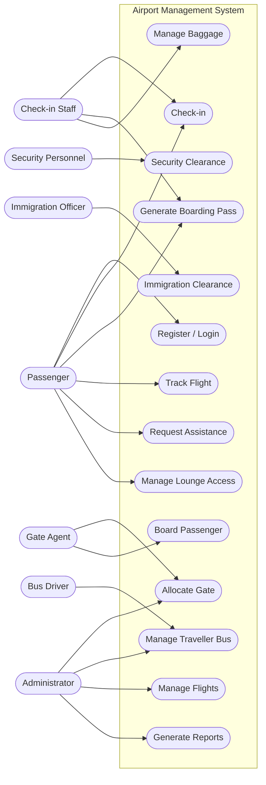

### Key Points

- Actors represent people or roles that interact with the system.
- Use cases represent system functions.
- The system boundary separates the system's functions from external actors.
- Connections show participation in a function; they do not by themselves specify detailed authorization rules.

---

## 2. Class Diagram

**Purpose:** Shows the static structure of the system through classes, attributes, operations, and relationships.

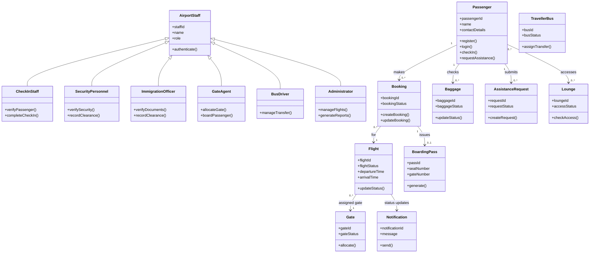

### Relationship Types Represented

- **Inheritance:** Specialized staff roles inherit shared properties and behavior from `AirportStaff`.
- **Association:** Passengers make bookings; bookings relate to flights.
- **Dependency:** Operational workflows use relevant services such as check-in, clearance, gate management, and notifications.
- **Composition:** A strong ownership relationship can be used where the final detailed model defines a component's lifecycle as dependent on its parent.

> The presentation identifies the major classes and relationship types but does not define every attribute, method, or multiplicity. Those details in this recreated diagram are illustrative and should be aligned with the final class diagram if exact matching is required.

---

## 3. Sequence Diagrams

**Purpose:** Show the chronological messages exchanged between actors and system objects.

### 3.1 Passenger Check-in

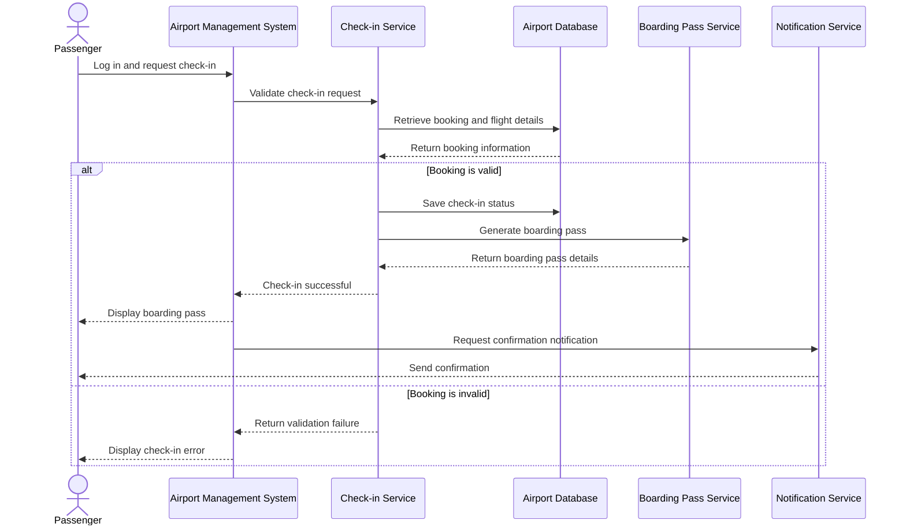

**Workflow:** The passenger requests check-in; the system validates the booking and flight details, records successful check-in, and generates a boarding pass. An invalid booking results in an error.

### 3.2 Baggage Processing & Security Clearance

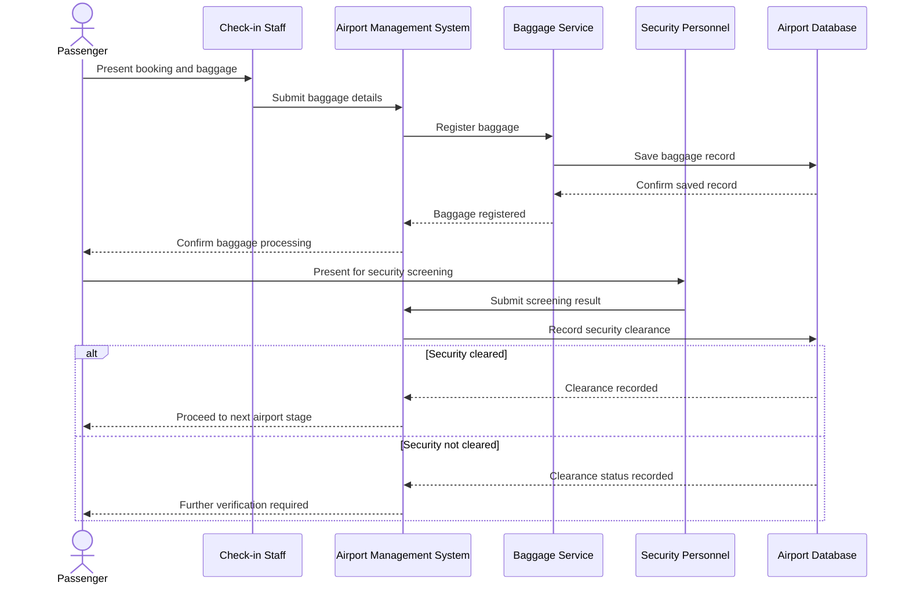

**Workflow:** Baggage details are registered and stored. Security personnel submit a screening result, and the system records the clearance outcome.

### 3.3 Passenger Boarding

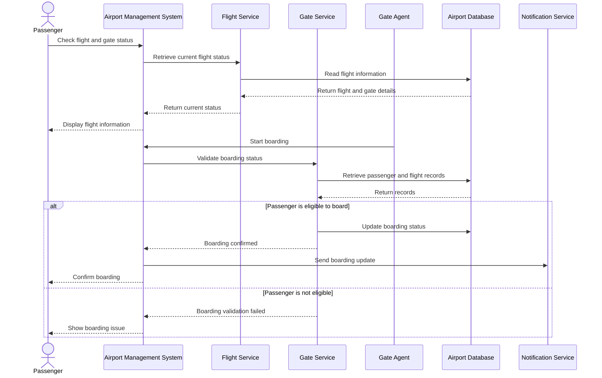

**Workflow:** The passenger checks the flight and gate status. When boarding begins, the system validates boarding eligibility and records the result.

### 3.4 Traveller-Bus Transportation

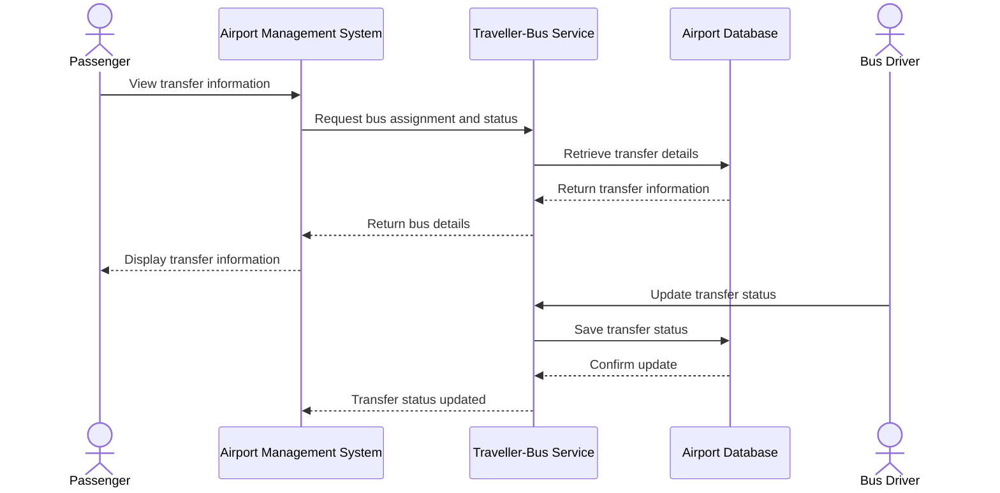

This conceptual sequence represents the traveller-bus management capability listed in the project presentation.

---

## 4. State Chart Diagram

**Purpose:** Models flight states and the events that cause transitions during the flight lifecycle.

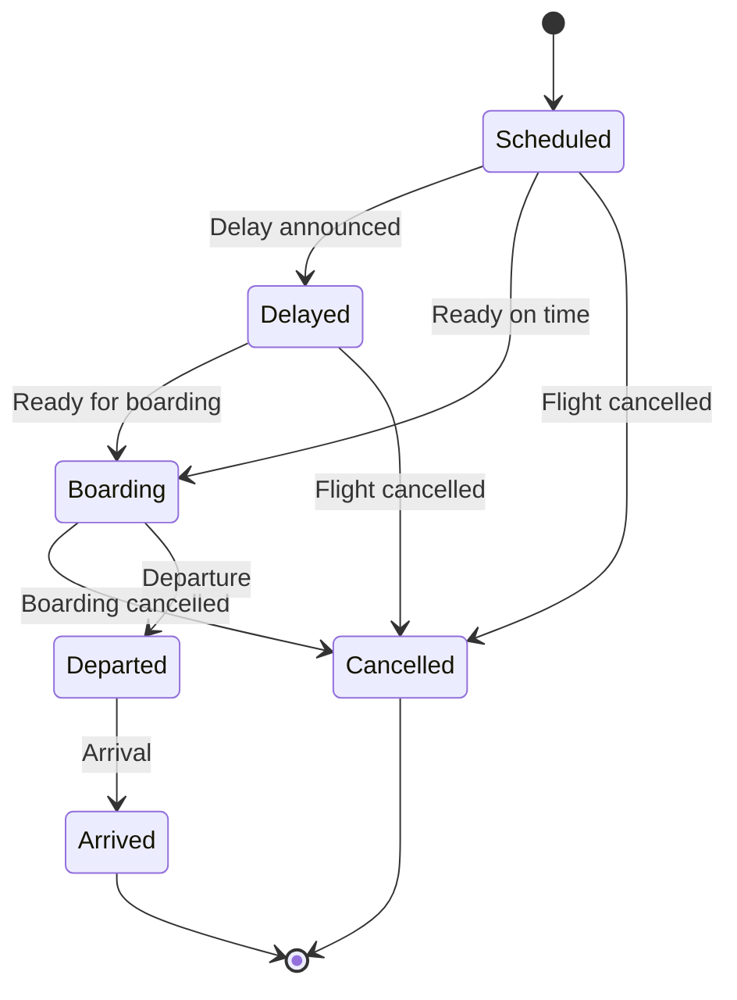

| State | Meaning |
|---|---|
| Scheduled | The flight is planned |
| Delayed | The flight has been delayed |
| Boarding | Passenger boarding has begun |
| Departed | The flight has left |
| Arrived | The flight has reached its destination |
| Cancelled | The flight will not operate as scheduled |

**Primary path:** `Scheduled → Boarding → Departed → Arrived`

**Alternate paths:** A flight may be delayed or cancelled before departure.

---

## 5. Activity Diagram

**Purpose:** Represents the passenger workflow and its decision points.

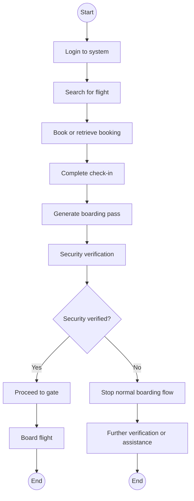

### Workflow Steps

1. Login to the system.
2. Search for a flight.
3. Book or retrieve a booking.
4. Complete check-in.
5. Generate a boarding pass.
6. Verify security clearance.
7. Proceed to the gate and board if verification succeeds.
8. If verification fails, stop the normal boarding flow and seek further review.

---

## 6. Component Diagram

**Purpose:** Shows the logical software components and their dependencies.

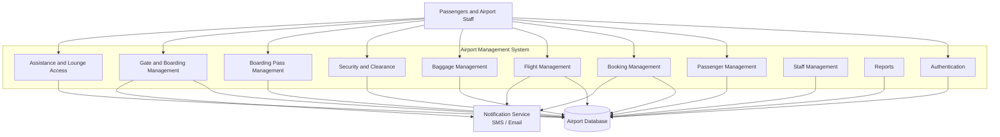

**Explanation:** Separate components handle authentication, passenger management, booking, flights, baggage, security, boarding passes, gates, staff, assistance, and reports. The components use the airport database for persistent data, and the notification service represents SMS/email communications.

---

## 7. Deployment Diagram

**Purpose:** Shows the intended deployment environment across client devices, application services, data storage, and notification infrastructure.

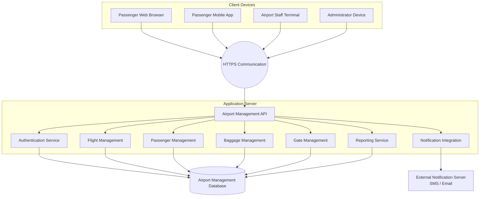

### Deployment Elements

- **Client devices:** Passenger browsers, mobile apps, staff terminals, and administrator devices.
- **Communication:** Client requests are represented as HTTPS communication.
- **Application server:** Hosts the Airport Management API and logical airport services.
- **Database:** Stores and retrieves operational information.
- **Notification server:** Represents SMS and email communication services.

> This diagram represents the logical deployment described in the presentation. It does not assert that these services have been implemented or deployed to a live airport environment.

---

## ✈️ Flight Lifecycle

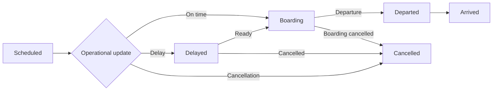

This lifecycle captures the primary flight states and the alternative delay/cancellation paths described in the project presentation.

---

## 🗂️ Core System Entities

| Entity / Class | Responsibility |
|---|---|
| Passenger | Represents a traveller using airport services |
| AirportStaff | Common representation of airport personnel |
| CheckInStaff | Supports passenger check-in |
| SecurityPersonnel | Records security verification |
| ImmigrationOfficer | Performs immigration clearance |
| GateAgent | Supports gate allocation and boarding |
| BusDriver | Supports traveller-bus operations |
| Administrator | Manages flight-related information and reports |
| Flight | Represents a scheduled flight and its lifecycle |
| Booking | Represents a passenger's booking |
| BoardingPass | Represents boarding-pass information |
| Baggage | Represents baggage and its processing status |
| Gate | Represents a gate and its allocation status |
| TravellerBus | Represents traveller-bus transportation |
| AssistanceRequest | Represents a passenger assistance request |
| Lounge | Represents lounge-access information |
| Notification | Represents a system notification |

---

## ✅ Key Benefits

- Helps reduce passenger waiting time and gate congestion.
- Improves coordination between airport departments.
- Organizes passenger, baggage, and flight management.
- Supports flight and gate status updates.
- Models security, boarding, and traveller transportation workflows.
- Provides a structured foundation for future system implementation.

---

## 👨‍💻 Team Members

**Team 7 — Object-Oriented Analysis and Design using UML**

| Name | Roll Number |
|---|---|
| Pranav Vedula | 24B11CS355 |
| Posa Kaveri | 24B11CS352 |
| M. Satya Harsha Vardhan Reddy | 24B11CS275 |
| Bodhanapu Suhas | 24B11CS049 |

---

## 📝 Notes

- This repository documentation is based on the **Airport Management System — OOAD Project Review** presentation.
- The README includes Mermaid recreations of the seven UML diagram types covered in the presentation: Use Case, Class, Sequence, State Chart, Activity, Component, and Deployment.
- Some class attributes, operation names, relationships, and service boundaries are illustrative where the presentation does not provide detailed specifications.
- Mermaid diagrams are rendered by GitHub in supported Markdown views.

### Viewing the Diagrams

1. Save this document as `README.md`.
2. Add it to the root of your OOADUML GitHub repository.
3. Commit and push the file.
4. Open the repository page to view the rendered diagrams.

---

**OOAD Project Review · Team 7**

*Airport Management System — Modeling airport operations with UML*

